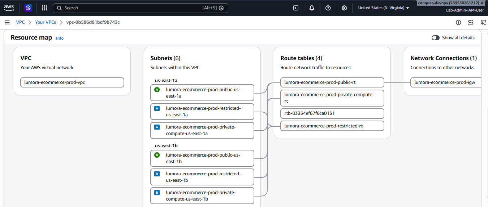

# Lumora E-Commerce DevOps Platform

## Master DevOps Architecture, Principles, and Platform Engineering Guide

This repository hosts the source code, Infrastructure as Code, configuration playbooks, Kubernetes manifests, and CI/CD pipelines for Lumora, a production-grade full-stack e-commerce application built on Python Flask and MongoDB.

This master documentation is designed as the primary technical reference for platform engineering, architectural evaluation, and operational procedures implemented throughout this capstone project.

---

## Table of Contents

1. [Technical and DevOps Components](#1-technical-and-devops-components)
2. [DevOps Principles Implemented](#2-devops-principles-implemented)
3. [End-to-End System Architecture with Visual Proofs](#3-end-to-end-system-architecture-with-visual-proofs)
4. [CI/CD Workflow and Pipeline Stages with In-Context Proofs](#4-cicd-workflow-and-pipeline-stages-with-in-context-proofs)
5. [Component Deep-Dive Documentation Links](#5-component-deep-dive-documentation-links)

---

## 1. Technical and DevOps Components

The platform integrates industry-standard tools across every phase of the software delivery lifecycle:

| Lifecycle Phase | Tool / Technology | Version / Specification | Technical Role in Lumora Platform |
| :--- | :--- | :--- | :--- |
| **Application Runtime** | Python / Flask | 3.12 / Flask 3.1.1 | Core RESTful web framework, templating, session state, and business logic |
| **Database Workload** | MongoDB | 7.0 Community | Document database storing product catalogs, user accounts, and transactions |
| **Web Server Gateway** | Gunicorn | 23.0.0 (2 Workers) | Production WSGI HTTP server binding port 5000 |
| **Container Engine** | Docker & Docker BuildKit | 26.x Engine / containerd | Multi-stage image build, non-root user execution (`appuser`), layer caching |
| **Container Registry** | Amazon ECR | Private Registry | Stores immutable, semantically tagged container images (`lumora-ecommerce-flask`) |
| **Infrastructure as Code** | HashiCorp Terraform | 1.8+ | Declarative multi-module infrastructure provisioning on AWS |
| **Remote State Backend** | AWS S3 + S3 Lockfile | AES-256 encrypted | Persistent remote state storage with native concurrency lock prevention |
| **Configuration Mgmt** | Ansible | 2.16+ Core | Idempotent host configuration, dependency installation, and tool bootstrapping |
| **CI/CD Orchestrator** | Jenkins LTS | 2.452+ (AWS EC2) | Declarative pipeline: test, scan, build, IaC, ECR push, GitOps image-tag commit |
| **GitOps / CD** | Argo CD | in-cluster (`argocd`) | Auto-sync + self-heal of `k8s/` manifests into `lumora-prod` |
| **Container Orchestration**| Amazon EKS | Kubernetes v1.36 | Managed Kubernetes control plane and multi-AZ EC2 worker node groups |
| **Ingress & Networking** | AWS ALB Ingress Controller | AWS Load Balancer Controller | Internet-facing application load balancing, TLS termination, and pod routing |
| **Auto-scaling** | Kubernetes HPA | HorizontalPodAutoscaler v2 | Dynamic pod scaling (2 to 5 replicas) based on CPU (70%) and Memory (80%) |
| **Secrets Management** | AWS Secrets Manager + CSI | Secrets Store CSI Driver | Out-of-band secret retrieval; zero credentials committed to source control |
| **Security Scanning** | Trivy | High/Critical Severity | Automated static analysis and image vulnerability scanning in CI pipeline |
| **Secret Leak Detection**| Gitleaks | v8.30.1 | Git history static credential audit guaranteeing zero leaked secrets |
| **Shift-Left FinOps** | Infracost CLI | Non-blocking Breakdown | Automated infrastructure monthly cost estimation during `terraform plan` |
| **Cost Governance** | AWS Budgets | $25/month threshold alarms| Real-time spend tracking with multi-tier email alerts at 80% and 100% |
| **Observability & Monitoring**| Prometheus & Grafana | kube-prometheus-stack | Cluster metrics scraping, resource saturation monitoring, and KPI dashboards |

---

## 2. DevOps Principles Implemented

The architecture adheres strictly to core DevOps and Site Reliability Engineering (SRE) paradigms:

### 2.1. Maximum Automation with Minimal Human Intervention
Every operational step—from dependency verification, infrastructure linting, security scanning, container packaging, to artifact promotion—is codified. Manual steps are restricted exclusively to a single governance gate: approval of production infrastructure modifications on the `main` branch.

### 2.2. Infrastructure as Code (IaC) and Reproducibility
No cloud resources are provisioned manually via the AWS Management Console. All networks, subnets, route tables, security boundaries, compute instances, storage volumes, and IAM roles are expressed as modular, parameterized Terraform configurations under version control.

### 2.3. Idempotent Configuration Management
Ansible playbooks are designed so that running them once or one hundred times yields the exact same desired system state without side effects, redundant service restarts, or configuration drift.

### 2.4. Shift-Left Security (DevSecOps)
Security is integrated at the earliest stages of the commit lifecycle:
- Gitleaks audits the entire Git commit history to guarantee zero leaked secrets, API keys, or private keys.
- Docker builds enforce non-root privilege execution.
- `.dockerignore` strictly isolates infrastructure code, SSH keys, logs, and artifacts from entering container images.
- Trivy performs static vulnerability scans on built images before they can be pushed to Amazon ECR.
- Sensitive passwords and tokens are never embedded into Git repositories or Kubernetes YAML manifests; they are dynamically injected via the AWS Secrets Store CSI Driver.

### 2.5. Shift-Left FinOps (Cost Transparency and Governance)
Cloud cost visibility is integrated into the developer workflow. Infracost evaluates every Terraform plan against AWS pricing APIs to forecast monthly financial deltas. In addition, an AWS Budget alarm enforces a strict $25/month project limit, and modular cost toggles (`enable_eks = false`, `enable_nat_gateway = false`) allow spinning down heavy cloud compute when not actively executing live workload tests.

### 2.6. Immutability and Semantic Tagging
Container images are immutable. Once built, tested, and scanned, the exact same container artifact is promoted through environments. Every image is tagged with both the unique Jenkins build number and the Git commit SHA. The live cluster tag is recorded in `k8s/kustomization.yml` (`images.newTag`) so Git remains the source of truth.

### 2.7. GitOps Continuous Delivery
Jenkins does **not** run `kubectl apply` for the storefront. After pushing to ECR it commits the new image tag to Git; Argo CD reconciles `path: k8s` on `main` into `lumora-prod` with automated prune and self-heal (`argocd/application.yaml`). HPA-owned `/spec/replicas` is ignored so autoscaling is not reset.

### 2.8. Decoupled Reliability and Self-Healing
Kubernetes health monitoring decouples liveness from readiness:
- The `/health` and `/health/live` endpoint verifies the responsiveness of the web process itself.
- The `/health/ready` endpoint verifies backing database connectivity.
If MongoDB experiences transient latency, the pod is gracefully detached from traffic routing without triggering destructive container restarts.

---

## 3. End-to-End System Architecture with Visual Proofs

The complete production cloud architecture, multi-AZ network layout, container workloads, and GitOps CI/CD flow are shown below:

*Direct Artifact References:*
- [`Lumora_E-Commerce_Architecture_v4.jpg`](../project_artifacts/Lumora_E-Commerce_Architecture_v4.jpg) — end-to-end AWS DevOps & GitOps
- [`Lumora_E-Commerce_GitOps_Platform_v4.jpg`](../project_artifacts/Lumora_E-Commerce_GitOps_Platform_v4.jpg) — dual-AZ 3-tier EKS + Argo CD


### Visual Implementation Evidence

#### 1. AWS VPC Multi-AZ Subnets & Route Tables


#### 2. Kubernetes Workloads Running in `lumora-prod` Namespace


#### 3. Live Storefront Loaded via Ingress ALB & Cloudflare


#### 4. Live Back-Office Administrative & Financial Control Center


---

## 4. CI/CD Workflow and Pipeline Stages with In-Context Proofs

The Jenkins Declarative Pipeline ([Jenkinsfile](../Jenkinsfile)) executes structured Shift-Left stages upon every code push:

```
Stage 1: Checkout SCM
  └── Pulls latest commit from GitHub repository via GitSCM.

Stage 2: Validate Prerequisites
  └── Verifies presence of Terraform, AWS CLI, and active AWS IAM session identity.

Stage 3: Application Test (Pytest)
  └── Fail-fast gate: Runs unit tests, endpoint validation, and mock MongoDB database tests with JUnit XML reporting.

Stage 4: Ansible Configuration Check
  └── Fail-fast gate: Validates syntax of Ansible playbooks against local inventories.

Stage 5: Gitleaks Repository Secret Scan
  └── Security Quality Gate: Audits repository & Git history for plaintext credentials; generates and archives `gitleaks-report.json`.

Stage 6: Docker Build
  └── Packages container image using BuildKit with non-root security standards (`appuser`).

Stage 7: Trivy Container Security Scan
  └── Security Quality Gate: Scans container image for vulnerabilities, archives JSON report, and blocks fixable CRITICAL CVEs.

Stage 8: Terraform Init
  └── Initializes remote S3 state backend with native concurrency locking.

Stage 9: Terraform Format Check
  └── Validates canonical HCL syntax using `terraform fmt -check -recursive`.

Stage 10: Terraform Validate
  └── Verifies semantic validity of modules, variables, and resource schemas.

Stage 11: Terraform Plan
  └── Synthesizes execution graph and writes binary plan file `tfplan`.

Stage 12: Archive Terraform Plan
  └── Persists `tfplan.txt` as a Jenkins fingerprint artifact for governance review.

Stage 13: FinOps Cost Estimation (Infracost)
  └── Evaluates infrastructure cost impact and archives breakdown table.

Stage 14: Terraform Apply Approval Gate
  └── Halts pipeline on `main` branch awaiting authorized engineering review.

Stage 15: Terraform Apply
  └── Applies approved infrastructure modifications idempotently to AWS.

Stage 16: Push Docker Image to AWS ECR
  └── Authenticates Docker to AWS ECR and pushes immutable tag (`build-${BUILD_NUMBER}-${GIT_COMMIT}`).

Stage 17: Publish Image Tag for Argo CD
  └── Updates `k8s/kustomization.yml` `newTag`, commits with `[skip ci]`, and pushes to `main` (Git = desired state).

Stage 18: Ensure Metrics Server
  └── Idempotently ensures Metrics Server / Secrets Store CSI add-ons are present.

Stage 19: Verify Argo CD Rollout
  └── Read-only poll until live Deployment image matches the published tag; smoke-tests `/health`.

Stage 20: Post-Deployment Health Check
  └── Executes live HTTP `/health` smoke test via in-cluster service DNS.

Stage 21: Deploy and Verify Monitoring
  └── Verifies Prometheus Operator CRDs, applies ServiceMonitor & alerts, and confirms `/metrics` scraping target is UP.
```

### Visual CI/CD & Security Evidence

#### 4. Jenkins Declarative Pipeline Run (CI + GitOps hand-off)


#### 5. Infracost Shift-Left Financial Breakdown Report


#### 6. Trivy Container Vulnerability Scan Console Output


---

## 5. Component Deep-Dive Documentation Links

For comprehensive technical specifications, implementation details, and role-specific configurations, consult the individual component guides and directory READMEs:

### Component Architecture Guides & Directory READMEs

| Component | Technical Deep-Dive Guide | Component Source & Directory README | Operational Scope & Coverage |
| :--- | :--- | :--- | :--- |
| **CI/CD Pipeline** | [Jenkins CI/CD Architecture Guide](./jenkins.md) | [Jenkins Declarative Pipeline](../Jenkinsfile) | CI pipeline: tests, Trivy, ECR push, GitOps tag commit, Argo CD verify |
| **GitOps / CD** | [Argo CD Application](../argocd/application.yaml) | [Kubernetes Manifests README](../k8s/README.md) | Argo CD Application `lumora-prod`, auto-sync, prune, self-heal |
| **Infrastructure as Code** | [Terraform Architecture & Networking Guide](./terraform.md) | [Terraform Module README](../terraform/README.md) | Multi-AZ VPC, subnets, NAT Gateways, ECR repository, EKS cluster, S3 remote state locking |
| **Configuration Mgmt** | [Ansible Playbooks & Roles Guide](./ansible.md) | [Ansible Directory README](../ansible/README.md) | Idempotent controller setup, role-based architecture, strict host-key verification |
| **Container Orchestration** | [Kubernetes Workloads & EKS Guide](./kubernetes.md) | [Kubernetes Manifests README](../k8s/README.md) | RollingUpdate deployments, ClusterIP service, ALB Ingress, HPA v2, MongoDB StatefulSet |
| **Observability & SRE** | [Monitoring, Prometheus & Grafana Guide](./monitoring.md) | [Monitoring Assets README](../monitoring/README.md) | kube-prometheus-stack, standalone Grafana EBS PVC, PrometheusRule alerts, ServiceMonitor |
| **DevSecOps & FinOps** | [Shift-Left Security & FinOps Governance](./security-and-finops.md) | [Project Security Overview](./security-and-finops.md) | Gitleaks secret detection, non-root containers, Secrets Store CSI, Infracost, AWS Budgets |

### Quick Links to Technical Guides
- [Jenkins CI/CD Pipeline & Controller Architecture](./jenkins.md)
- [Terraform Infrastructure as Code & AWS Network Topology](./terraform.md)
- [Ansible Configuration Management & Modular Playbooks](./ansible.md)
- [Kubernetes Workloads, EKS Orchestration & CSI Secrets](./kubernetes.md)
- [Observability, Prometheus, Grafana & Metrics Server](./monitoring.md)
- [Shift-Left Security (DevSecOps) & FinOps Cost Governance](./security-and-finops.md)
- [Project Repository Root README](../README.md)
