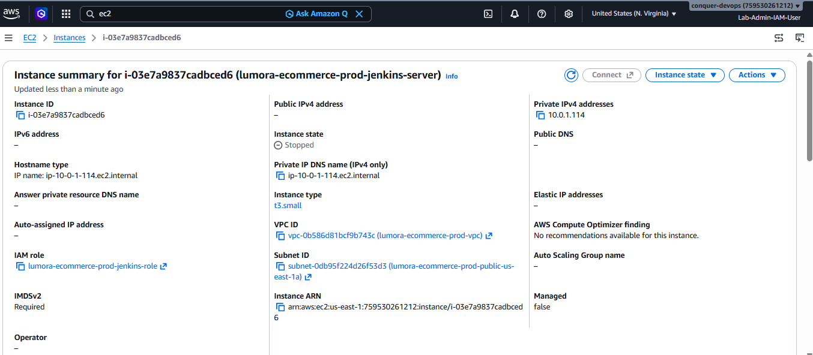
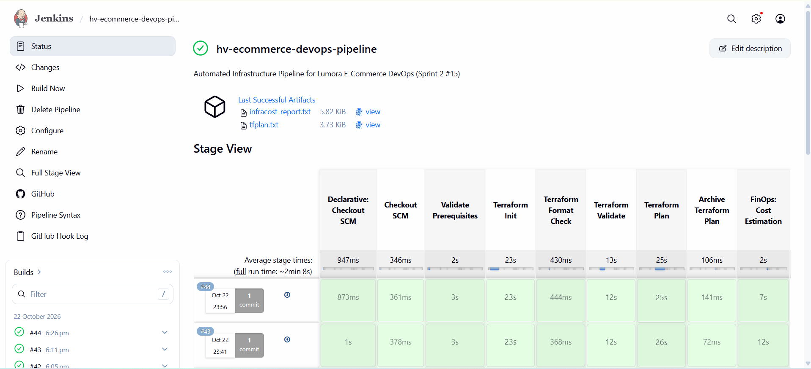
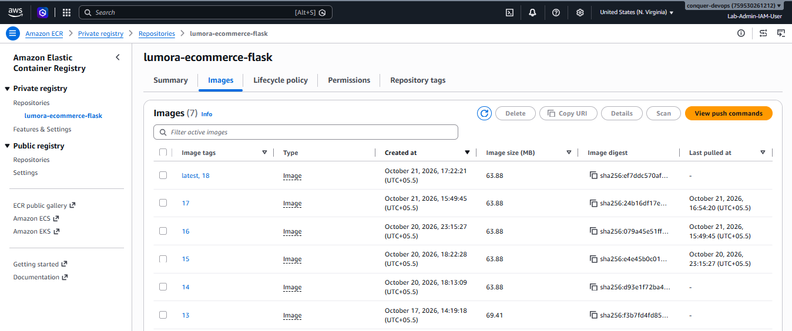

# CI/CD Orchestration with Jenkins

This document provides a technical deep-dive into the Continuous Integration and Continuous Delivery (CI/CD) architecture implemented for the Lumora E-Commerce platform using Jenkins.

---

## Table of Contents

1. [Architecture and Controller Provisioning](#1-architecture-and-controller-provisioning)
2. [Declarative Pipeline Overview](#2-declarative-pipeline-overview)
3. [Detailed Stage-by-Stage Breakdown with In-Context Proofs](#3-detailed-stage-by-stage-breakdown-with-in-context-proofs)
4. [GitHub Integration and Webhook Automation](#4-github-integration-and-webhook-automation)
5. [Pipeline Resilience and Failure Handling](#5-pipeline-resilience-and-failure-handling)

---

## 1. Architecture and Controller Provisioning

The Jenkins CI/CD controller is deployed on an Amazon EC2 instance within the Lumora public subnet, managed via Terraform and configured via Ansible.

| Attribute | Specification | Operational Context |
| :--- | :--- | :--- |
| **Instance Type** | `t3.small` (2 vCPU, 2 GiB RAM) | Right-sized for running controller builds and lightweight orchestration |
| **Operating System** | Ubuntu 24.04 LTS (Noble) | Long-term support base image |
| **Networking** | Public Subnet 1 (`10.0.1.0/24`) | Direct internet access for GitHub webhooks and package repos |
| **Static Public IP** | AWS Elastic IP (`32.195.28.191`) | Fixed IP prevents webhook disruption upon instance restarts |
| **Security Group** | Port 8080 (Jenkins UI), Port 22 (SSH) | Ingress restricted to administration and GitHub webhook CIDRs |
| **IAM Instance Profile** | `lumora-ecommerce-prod-jenkins-role` | Grants controller least-privilege access to ECR, EKS, and S3 |
| **State Protection** | `lifecycle { ignore_changes = [ami] }`| Prevents unintentional EC2 destruction during Terraform applies |

#### Jenkins Web Controller Dashboard


#### AWS EC2 Host Instance & Networking Configuration


---

## 2. Declarative Pipeline Overview

The pipeline is codified entirely in the root [Jenkinsfile](file:///d:/HeroVired/Capstone/Saro/hv-ecommerce-devops/Jenkinsfile). It executes 16 sequential stages spanning code validation, infrastructure management, containerization, security scanning, artifact promotion, and Kubernetes deployment.

| 16-Stage Pipeline Stage View | Multi-Branch Pipeline Job Overview |
| :---: | :---: |
|  |  |

---

## 3. Detailed Stage-by-Stage Breakdown with In-Context Proofs

### Stage 1: Checkout SCM
- Pulls source code from GitHub (`https://github.com/Saranyaharish93/hv-ecommerce-devops.git`).
- Tracks the commit SHA and associates build logs with developer changes.

### Stage 2: Validate Prerequisites
- Executes CLI pre-flight verification: `terraform version`, `aws --version`, `infracost --version`.
- Runs `aws sts get-caller-identity` to guarantee that the instance profile has valid credentials before making any AWS API calls.

### Stage 3: Terraform Init
- Points to the `terraform/` working directory.
- Initializes the remote S3 state backend (`lumora-ecommerce-prod-tfstate-us-east-1`) with native concurrency locking enabled (`-input=false -no-color`).

### Stage 4: Terraform Format Check
- Enforces code hygiene across all team members: `terraform fmt -check -recursive -no-color`.
- If an unformatted HCL file is committed, the pipeline immediately fails before any plan is created.

### Stage 5: Terraform Validate
- Semantically parses all modules (`vpc`, `security_groups`, `ecr`, `jenkins`, `eks`).
- Validates variable mappings, type definitions, and resource schemas.

### Stage 6 & 7: Terraform Plan & Archive Plan
- Generates a deterministic execution plan saved to binary file `tfplan`.
- Converts the plan to human-readable text: `terraform show -no-color tfplan > tfplan.txt`.
- Archives `tfplan.txt` as a fingerprint Jenkins artifact so engineers and evaluators can inspect every planned cloud resource modification prior to application.

### Stage 8: FinOps Cost Estimation (Infracost)
- Infracost evaluates `tfplan` against AWS pricing tables.
- Emits a tabular financial report (`infracost-report.txt`) showing baseline costs, usage variations, and total monthly cloud projection.
- Configured with a 20-second timeout and exception guard so pipeline execution is never blocked if API keys are rotating.


### Stage 9 & 10: Terraform Apply Approval & Apply
- On the `main` branch, a manual interactive approval gate (`input message: 'Review the archived Terraform plan. Apply infrastructure changes?'`) pauses execution.
- Once approved, `terraform apply -input=false -auto-approve tfplan` executes the planned infrastructure updates without recalculating the graph.


### Stage 11: Ansible Configuration Check
- Changes directory to `ansible/` and validates syntax:
  ```bash
  ansible-playbook -i inventory/hosts.ini --syntax-check playbooks/setup_jenkins.yml
  ```
- Ensures playbooks are syntactically sound and roles are correctly resolved prior to host configuration.

### Stage 12: Application Test (Pytest)
- Installs dependencies from [requirements.txt](file:///d:/HeroVired/Capstone/Saro/hv-ecommerce-devops/requirements.txt), including `pytest` and `mongomock`.
- Executes automated test suites in `tests/`:
  - `test_health`: Verifies that the `/health` endpoint returns HTTP 200 and status `UP`.
  - `test_products_api_has_seed_data`: Tests API endpoint payload serialization.
  - `test_forgot_password_creates_token`: Validates token creation and outbox simulation.
  - `test_admin_reports_requires_admin`: Confirms role-based access control (RBAC).

### Stage 13: Docker Build
- Executes Docker BuildKit packaging:
  ```bash
  docker build -t lumora-ecommerce-flask:${IMAGE_TAG} -t lumora-ecommerce-flask:latest .
  ```
- Utilizes layer caching and respects [.dockerignore](file:///d:/HeroVired/Capstone/Saro/hv-ecommerce-devops/.dockerignore) to prevent leaking keys or infrastructure manifests into image layers.

### Stage 14: Trivy Container Security Scan
- Scans the built image for operating system and application dependency vulnerabilities:
  ```bash
  trivy image --severity HIGH,CRITICAL --exit-code 0 --format table lumora-ecommerce-flask:${IMAGE_TAG}
  ```
- Generates a security vulnerability table directly within the Jenkins build console.


### Stage 15: Push Docker Image to AWS ECR
- Authenticates Docker securely via AWS IAM authorization token:
  ```bash
  aws ecr get-login-password --region us-east-1 | docker login --username AWS --password-stdin 759530261212.dkr.ecr.us-east-1.amazonaws.com
  ```
- Tags the image with both the unique build number `${BUILD_NUMBER}` and `latest`.
- Pushes both tags to the private Amazon ECR repository.



### Stage 16: Deploy to EKS & Setup Metrics Server (Conditional Guard)
- The pipeline checks if the EKS cluster is active before attempting deployment:
  ```groovy
  expression {
      return sh(
          script: 'aws eks describe-cluster --name lumora-ecommerce-prod --region us-east-1 --query "cluster.status" --output text 2>/dev/null | grep -q "ACTIVE"',
          returnStatus: true
      ) == 0
  }
  ```
- If ACTIVE, it invokes `scripts/setup_metrics_server.sh` (ensuring Metrics Server and Secrets CSI Driver are installed), applies the Kubernetes manifests via Kustomize (`kubectl apply -k k8s/`), and blocks until `kubectl rollout status deployment/flask-app` successfully completes.

---

## 4. GitHub Integration and Webhook Automation

Automation between GitHub and Jenkins is configured via webhook triggers:

```
[Developer Push / PR Merge] 
       |
       v
GitHub Repository (Saranyaharish93/hv-ecommerce-devops)
       |
       v (POST http://32.195.28.191:8080/github-webhook/)
Jenkins Webhook Listener (GitHubPushTrigger)
       |
       v
hv-ecommerce-devops-pipeline (Automatic Execution)
```

The trigger is codified in the Ansible job template ([job.xml.j2](file:///d:/HeroVired/Capstone/Saro/hv-ecommerce-devops/ansible/roles/jenkins/templates/job.xml.j2)):
```xml
<triggers>
  <com.cloudbees.jenkins.GitHubPushTrigger plugin="github">
    <spec></spec>
  </com.cloudbees.jenkins.GitHubPushTrigger>
</triggers>
```


---

## 5. Pipeline Resilience and Failure Handling

The pipeline implements defensive programming practices:
1. **Workspace Hygiene (`cleanWs()`)**: The `post { always { deleteDir() } }` block purges the workspace after every build to prevent disk exhaustion.
2. **Concurrent Build Suppression**: `disableConcurrentBuilds()` prevents two overlapping builds from competing for the Terraform state lock.
3. **Log Rotation**: `buildDiscarder(logRotator(numToKeepStr: '10'))` maintains only the last 10 builds, keeping disk consumption predictable.
4. **Non-blocking FinOps Timeout**: Infracost execution is wrapped in a `timeout 20s` block to ensure missing or rate-limited API keys never cause pipeline hangs.


