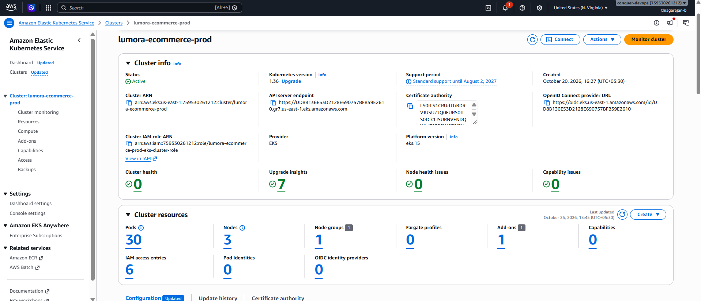
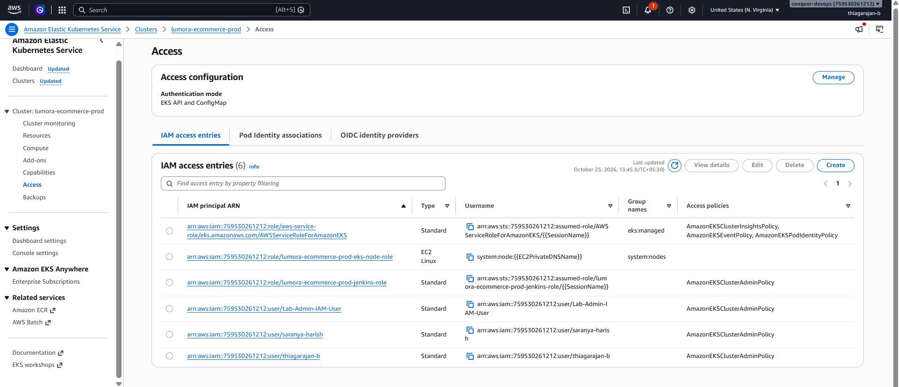
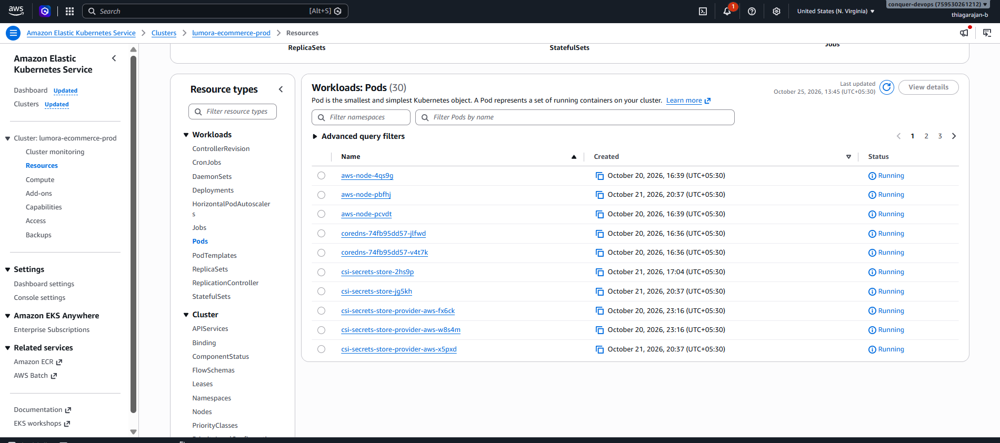
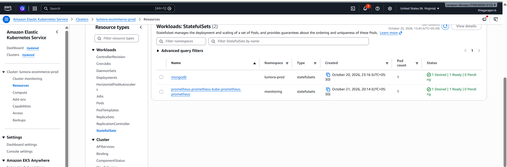
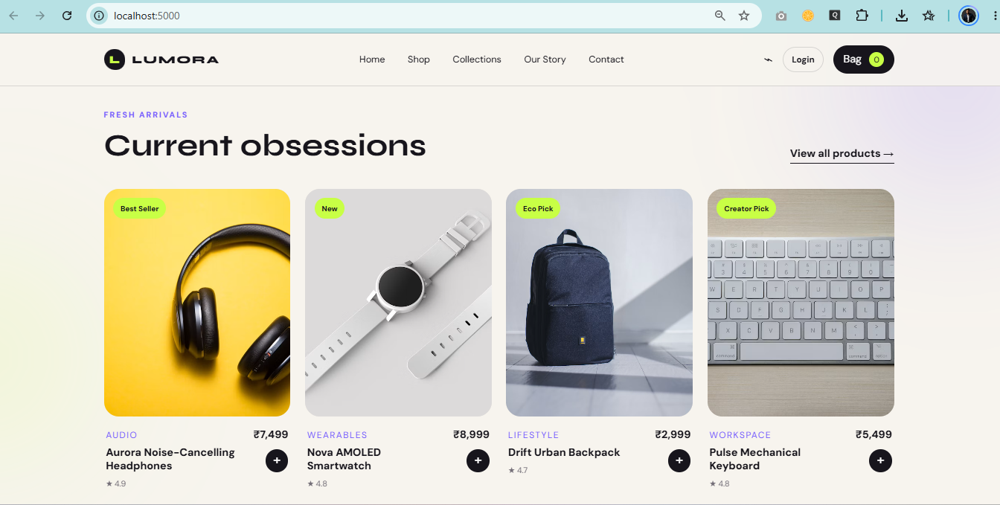

# Kubernetes Orchestration on Amazon EKS

This document details the container orchestration architecture, microservices deployment, volume persistence, auto-scaling, and secret injection implemented for the Lumora E-Commerce platform on Amazon Elastic Kubernetes Service (EKS).

---

## Table of Contents

1. [EKS Cluster Architecture with In-Context Node Proof](#1-eks-cluster-architecture-with-in-context-node-proof)
2. [Microservices Workload Architecture](#2-microservices-workload-architecture)
3. [Manifest Deep-Dive and Workload Proofs](#3-manifest-deep-dive-and-workload-proofs)
4. [Zero-Secret Git Policy via AWS Secrets Store CSI](#4-zero-secret-git-policy-via-aws-secrets-store-csi)
5. [Decoupled Liveness vs. Readiness Probes](#5-decoupled-liveness-vs-readiness-probes)
6. [Horizontal Pod Autoscaling (HPA v2) with Live Metrics Proof](#6-horizontal-pod-autoscaling-hpa-v2-with-live-metrics-proof)
7. [AWS Application Load Balancer Ingress with Storefront Proof](#7-aws-application-load-balancer-ingress-with-storefront-proof)

---

## 1. EKS Cluster Architecture with In-Context Node Proof

The application runs on a managed Amazon EKS cluster deployed across private subnets:

| Attribute | Specification | Architectural Role |
| :--- | :--- | :--- |
| **Cluster Name** | `lumora-ecommerce-prod` | Dedicated production cluster |
| **Kubernetes Version** | `1.36` | Up-to-date stable control plane |
| **Worker Nodes** | 2x `t3.small` EC2 Instances | Managed Node Group scaling between 2 and 4 nodes |
| **Subnet Placement** | Private Compute Subnets (`10.0.48.0/20`, `10.0.64.0/20`)| Nodes have no public IPs; isolated from external attacks |
| **Pod Networking** | AWS VPC CNI Plugin | Every pod gets a routable native VPC IP address |
| **Storage Driver** | AWS EBS CSI Driver (`aws-ebs-csi-driver`) | Dynamic volume provisioning backed by Amazon EBS `gp3` |
| **Cost Toggle** | `enable_eks = false` (default) | Pauses control plane and nodes to preserve budget when idle |

| EKS Cluster Overview Dashboard | EKS IAM Cluster Access Entries |
| :---: | :---: |
|  |  |

---

## 2. Microservices Workload Architecture

The application tier is split into stateless and stateful tiers within the dedicated `lumora-prod` namespace:


---

## 3. Manifest Deep-Dive and Workload Proofs

All manifests reside in the `k8s/` directory and are applied declaratively using Kustomize (`kubectl apply -k k8s/`):

```
k8s/
├── 00-namespace.yml           # Defines isolated 'lumora-prod' namespace
├── 01-configmap-secrets.yml   # Runtime config and SecretProviderClass pointer
├── 02-mongodb.yml             # Headless Service + StatefulSet with 10Gi EBS PVC
├── 03-flask-deployment.yml     # Flask web deployment (RollingUpdate, non-root CSI mount)
├── 04-hpa.yml                 # HorizontalPodAutoscaler scaling on CPU & Memory
├── 05-service-ingress.yml     # Internal ClusterIP Service and AWS ALB Ingress
└── kustomization.yml          # Kustomize manifest orchestrating all files
```

### 3.1. Stateless Application Tier: `03-flask-deployment.yml`
- **Rolling Updates**: `maxSurge: 1` and `maxUnavailable: 0` ensures zero-downtime rolling updates.
- **Resource Allocations**: Requests `100m CPU / 128Mi RAM`; limits set at `500m CPU / 512Mi RAM`.
- **Image Pull Policy**: Set to `Always` to pull freshly promoted images from Amazon ECR.
- **Cost Center Tagging**: Labeled with `cost-center: Multicloud-Mavericks`.

### 3.2. Stateful Database Tier: `02-mongodb.yml`
- **Workload Type**: Single-instance `StatefulSet` (`replicas: 1`) with stable network identity `mongodb-0`.
- **Durability & Persistence**: Backed by a dedicated 10 GiB Amazon EBS `gp3` PersistentVolumeClaim (`accessModes: ["ReadWriteOnce"]`) managed via the AWS EBS CSI driver. When a pod restarts or moves across worker nodes, EBS automatically re-attaches `/data/db` to guarantee zero data loss.
- **Scope & High-Availability Boundary**: Designed as single-node persistent storage for capstone resource efficiency. It provides storage durability across node lifecycle events, rather than a multi-node distributed replica set cluster.
- **Headless Service**: `clusterIP: None` enabling direct DNS resolution to the database pod (`mongodb-service.lumora-prod.svc.cluster.local:27017`).

| EKS Workload Health Status | Kubernetes Workloads in `lumora-prod` |
| :---: | :---: |
|  |  |

| Production Pods Console | StatefulSets & Persistent Volumes |
| :---: | :---: |
|  |  |

---

## 4. Zero-Secret Git Policy via AWS Secrets Store CSI

No plaintext database passwords or application secret keys exist in the git repository or Kubernetes manifests.

### The Dynamic Injection Flow:
```
[AWS Secrets Manager] (lumora-ecommerce-prod-secrets)
          |
          | (1. Node IAM Role retrieves encrypted JSON out-of-band)
          v
[Secrets Store CSI Driver]
          |
          +---> (2. Mounts secrets in memory at /mnt/secrets-store)
          |
          +---> (3. Syncs keys into Kubernetes Opaque Secret 'flask-secrets')
                     |
                     v
          [Flask & MongoDB Containers]
          (Pulls MONGO_INITDB_ROOT_PASSWORD, SECRET_KEY, ADMIN_PASSWORD)
```

Manifest implementation in [k8s/01-configmap-secrets.yml](file:///d:/HeroVired/Capstone/Saro/hv-ecommerce-devops/k8s/01-configmap-secrets.yml):
```yaml
apiVersion: secrets-store.csi.x-k8s.io/v1
kind: SecretProviderClass
metadata:
  name: aws-secrets-provider
  namespace: lumora-prod
spec:
  provider: aws
  parameters:
    objects: |
      - objectName: "lumora-ecommerce-prod-secrets"
        objectType: "secretsmanager"
        jmesPath: 
          - path: "SECRET_KEY"
            objectAlias: "SECRET_KEY"
          - path: "ADMIN_PASSWORD"
            objectAlias: "ADMIN_PASSWORD"
          - path: "MONGO_INITDB_ROOT_PASSWORD"
            objectAlias: "MONGO_INITDB_ROOT_PASSWORD"
  secretObjects:
    - secretName: flask-secrets
      type: Opaque
      data:
        - objectName: SECRET_KEY
          key: SECRET_KEY
        - objectName: ADMIN_PASSWORD
          key: ADMIN_PASSWORD
        - objectName: MONGO_INITDB_ROOT_PASSWORD
          key: MONGO_INITDB_ROOT_PASSWORD
```

---

## 5. Decoupled Liveness vs. Readiness Probes

Health checking is engineered to prevent cascading pod restart storms:

| Probe Type | Monitored Endpoint | Failure Threshold | Action on Failure |
| :--- | :--- | :---: | :--- |
| **Liveness Probe** | `/health` or `/health/live` | 3 failures (period: 15s) | Pod is terminated and restarted by the Kubelet |
| **Readiness Probe**| `/health/ready` | 2 failures (period: 10s) | Pod is temporarily removed from ALB service endpoints |

### Probe Implementation Logic:
- **Liveness** verifies whether Gunicorn and Python are running and responsive.
- **Readiness** actively runs `db.command("ping")`. If MongoDB experiences a failover, Flask pods remain alive while the load balancer stops routing traffic to them until the database reconnects.

---

## 6. Horizontal Pod Autoscaling (HPA v2) with Live Metrics Proof

Dynamic scaling is governed by [k8s/04-hpa.yml](file:///d:/HeroVired/Capstone/Saro/hv-ecommerce-devops/k8s/04-hpa.yml):

```yaml
apiVersion: autoscaling/v2
kind: HorizontalPodAutoscaler
metadata:
  name: flask-app-hpa
  namespace: lumora-prod
spec:
  scaleTargetRef:
    apiVersion: apps/v1
    kind: Deployment
    name: flask-app
  minReplicas: 2
  maxReplicas: 5
  metrics:
    - type: Resource
      resource:
        name: cpu
        target:
          type: Utilization
          averageUtilization: 70
    - type: Resource
      resource:
        name: memory
        target:
          type: Utilization
          averageUtilization: 80
```

- When average CPU utilization exceeds **70%** or Memory exceeds **80%**, the HPA automatically triggers additional replica pods (up to 5).
- As traffic normalizes, the HPA gradually scales down to the baseline of 2 pods.
- The Kubernetes Metrics Server is pre-flight validated by [scripts/setup_metrics_server.sh](file:///d:/HeroVired/Capstone/Saro/hv-ecommerce-devops/scripts/setup_metrics_server.sh) before the HPA is applied.


---

## 7. AWS Application Load Balancer Ingress with Storefront Proof

Ingress routing is handled by the AWS Load Balancer Controller ([k8s/05-service-ingress.yml](file:///d:/HeroVired/Capstone/Saro/hv-ecommerce-devops/k8s/05-service-ingress.yml)):

```yaml
apiVersion: networking.k8s.io/v1
kind: Ingress
metadata:
  name: flask-ingress
  namespace: lumora-prod
  annotations:
    kubernetes.io/ingress.class: alb
    alb.ingress.kubernetes.io/scheme: internet-facing
    alb.ingress.kubernetes.io/target-type: ip
    alb.ingress.kubernetes.io/healthcheck-path: /health
    alb.ingress.kubernetes.io/healthcheck-interval-seconds: "15"
    alb.ingress.kubernetes.io/success-codes: "200"
    alb.ingress.kubernetes.io/listen-ports: '[{"HTTP": 80}]'
spec:
  ingressClassName: alb
  rules:
    - http:
        paths:
          - path: /
            pathType: Prefix
            backend:
              service:
                name: flask-service
                port:
                  number: 80
```

- `target-type: ip`: Enables the ALB to route directly to pod IP addresses across private subnets, bypassing `NodePort` latency.
- Public requests arriving at port 80 are load-balanced across all healthy application pods.

| AWS Application Load Balancer Console | Live Storefront Ingress Endpoint |
| :---: | :---: |
|  |  |


