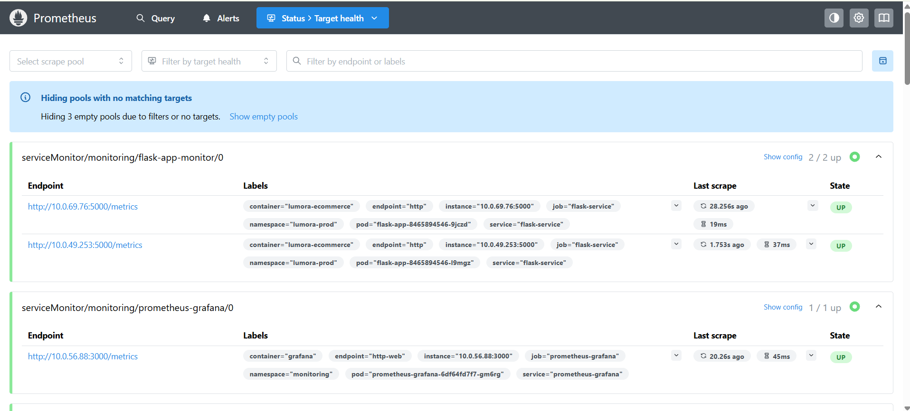
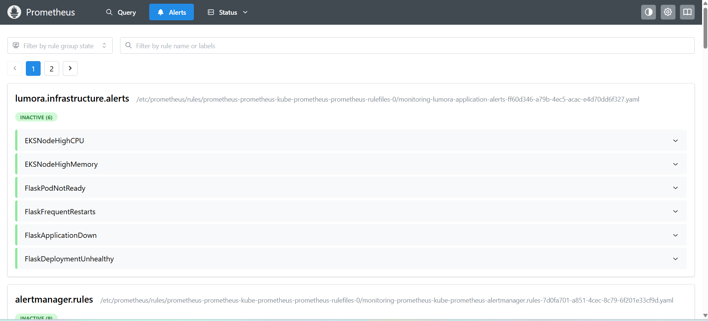
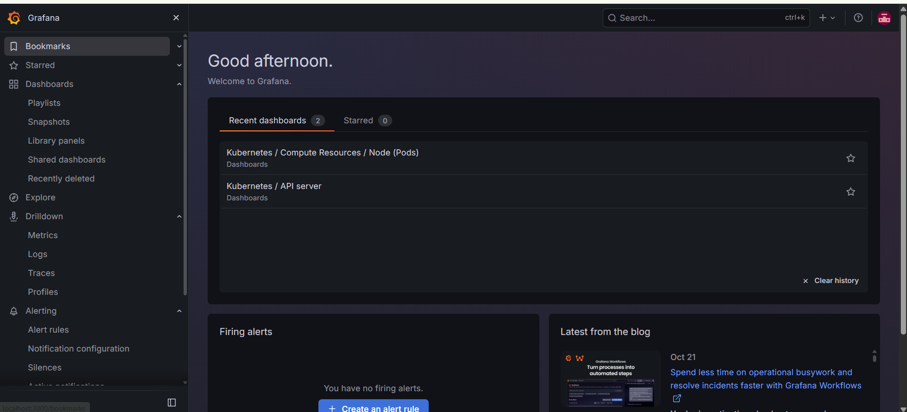
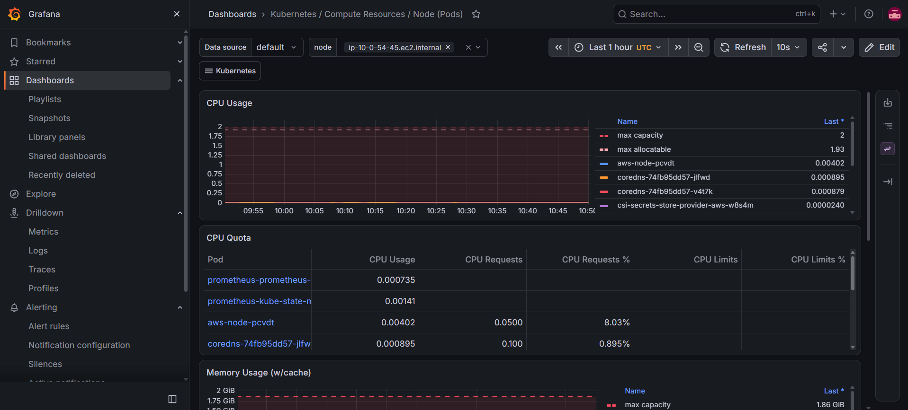

# Observability, Monitoring, and Alerting

This document outlines the observability, metrics collection, and alerting architecture designed for the Lumora E-Commerce platform across application, cluster, and infrastructure tiers.

---

## Table of Contents

1. [Observability Strategy and SRE Principles](#1-observability-strategy-and-sre-principles)
2. [Application Health Probes Codified in Python](#2-application-health-probes-codified-in-python)
3. [Kubernetes Pod Health Probes in Manifests](#3-kubernetes-pod-health-probes-in-manifests)
4. [Automated Metrics Server Bootstrap](#4-automated-metrics-server-bootstrap)
5. [Prometheus Helm Values & Scraping Specification](#5-prometheus-helm-values--scraping-specification)
6. [PrometheusRule Alerting Definitions as Code](#6-prometheusrule-alerting-definitions-as-code)
7. [Grafana Dashboards Codified in JSON](#7-grafana-dashboards-codified-in-json)

---

## 1. Observability Strategy and SRE Principles

The monitoring framework follows the Google Site Reliability Engineering (SRE) **Four Golden Signals**:
1. **Latency**: Time required to service client HTTP requests across endpoints (`/`, `/shop`, `/product/<id>`).
2. **Traffic**: Volume of incoming transactions measured in requests per second (RPS).
3. **Errors**: Rate of failed requests, categorized into 4xx (client errors) and 5xx (application / server errors).
4. **Saturation**: Utilization of critical infrastructure resources (Node CPU, Pod Memory vs Limit, EBS Disk IOPS).

---

## 2. Application Health Probes Codified in Python

Observability begins at the application layer. Rather than treating the Flask application as a black box, the codebase provides structured health diagnostics:

From [`app/routes.py`](file:///d:/HeroVired/Capstone/Saro/hv-ecommerce-devops/app/routes.py):
```python
@bp.get("/health")
@bp.get("/health/live")
def health_live():
    """Liveness probe: verifies that the web process is running."""
    return {"status": "UP", "service": "hv-ecommerce"}, 200


@bp.get("/health/ready")
def health_ready():
    """Readiness probe: verifies database connectivity safely."""
    try:
        current_app.db.command("ping")
        return {"status": "READY", "database": "connected"}, 200
    except Exception as e:
        return {"status": "DEGRADED", "database": str(e)}, 503
```

### Architectural Rationale:
- **Liveness (`/health`, `/health/live`)**: Returns HTTP 200 if the Gunicorn worker thread is unblocked. If an unhandled thread deadlock occurs, the liveness check fails, prompting Kubernetes to restart the container.
- **Readiness (`/health/ready`)**: Actively tests downstream database connectivity by executing a lightweight MongoDB `ping` command. If MongoDB is temporarily partitioned or re-electing a primary, the probe returns HTTP 503 (`DEGRADED`), preventing the ALB from directing user traffic to a pod that cannot complete transactions.

---

## 3. Kubernetes Pod Health Probes in Manifests

The Python endpoints are coupled to the Kubernetes control plane via probe definitions in the deployment manifest:

From [`k8s/03-flask-deployment.yml`](file:///d:/HeroVired/Capstone/Saro/hv-ecommerce-devops/k8s/03-flask-deployment.yml):
```yaml
          livenessProbe:
            httpGet:
              path: /health
              port: 5000
            initialDelaySeconds: 20
            periodSeconds: 15
            timeoutSeconds: 3
            failureThreshold: 3
          readinessProbe:
            httpGet:
              path: /health/ready
              port: 5000
            initialDelaySeconds: 15
            periodSeconds: 10
            timeoutSeconds: 3
            failureThreshold: 2
```

---

## 4. Automated Metrics Server Bootstrap

Kubernetes Horizontal Pod Autoscaling (HPA) requires an active resource metrics pipeline. We automate this pre-flight check in [scripts/setup_metrics_server.sh](file:///d:/HeroVired/Capstone/Saro/hv-ecommerce-devops/scripts/setup_metrics_server.sh):

```bash
# Verify if Metrics API Service is active
if ! kubectl get apiservice v1beta1.metrics.k8s.io >/dev/null 2>&1; then
    echo "Metrics Server API not detected. Installing official Kubernetes Metrics Server..."
    kubectl apply -f https://github.com/kubernetes-sigs/metrics-server/releases/latest/download/components.yaml
fi

# Wait for healthy rollout
kubectl rollout status deployment/metrics-server -n kube-system --timeout=120s

# Verify active metric reporting
kubectl top nodes
```

This script runs automatically during the Jenkins pipeline Stage 16 prior to deploying application workloads.

---

## 5. Prometheus Helm Values & Scraping Specification

Prometheus is deployed into the `monitoring` namespace using the `kube-prometheus-stack` Helm chart. The deployment is tuned for efficient resource usage on AWS EKS:

From [`monitoring/prometheus-values.yaml`](file:///d:/HeroVired/Capstone/Saro/hv-ecommerce-devops/monitoring/prometheus-values.yaml):
```yaml
prometheus:
  prometheusSpec:
    retention: 2d
    scrapeInterval: 30s
    evaluationInterval: 30s
    resources:
      requests:
        cpu: 100m
        memory: 400Mi
      limits:
        memory: 1Gi
    storageSpec:
      emptyDir: {}

grafana:
  enabled: false

alertmanager:
  enabled: false
```

- **Scrape Interval (30s)**: Balances real-time metric fidelity with network/CPU overhead on `t3.small` worker nodes.
- **Resource Limits (1Gi)**: Enforces memory boundaries to prevent the monitoring agent from triggering node OOM conditions.
- **Retention (2d)**: Right-sized for capstone execution and sprint demonstrations without exhausting EBS disk capacity.

### 5.1. Prometheus Target Scraping Verification

The screenshot below validates the Prometheus web console (`/targets`) actively scraping the Flask e-commerce application (`flask-app-monitor/0` across healthy endpoints on port 5000) and the Grafana service in the `UP (2/2)` state:



---

## 6. PrometheusRule Alerting Definitions as Code

Alert rules are declared as Kubernetes Custom Resources (`kind: PrometheusRule`) and managed under Git version control:

From [`monitoring/application-alerts.yaml`](file:///d:/HeroVired/Capstone/Saro/hv-ecommerce-devops/monitoring/application-alerts.yaml):
```yaml
apiVersion: monitoring.coreos.com/v1
kind: PrometheusRule
metadata:
  name: lumora-application-alerts
  namespace: monitoring
  labels:
    release: prometheus
spec:
  groups:
    - name: lumora.infrastructure.alerts
      rules:
        # 1. Host CPU Saturation Alert
        - alert: EKSNodeHighCPU
          expr: |
            100 * (1 - avg by (instance) (rate(node_cpu_seconds_total{mode="idle"}[5m]))) > 80
          for: 5m
          labels:
            severity: warning
            project: lumora
          annotations:
            summary: "High CPU usage on {{ $labels.instance }}"
            description: "Node CPU utilization has exceeded 80% for 5 minutes."

        # 2. Host RAM Exhaustion Alert
        - alert: EKSNodeHighMemory
          expr: |
            100 * (1 - node_memory_MemAvailable_bytes / node_memory_MemTotal_bytes) > 85
          for: 5m
          labels:
            severity: warning
            project: lumora
          annotations:
            summary: "High memory usage on {{ $labels.instance }}"
            description: "Node memory utilization has exceeded 85% for 5 minutes."

        # 3. Pod Health & Readiness Failure
        - alert: FlaskPodNotReady
          expr: |
            kube_pod_status_ready{namespace="lumora-prod", pod=~"flask-app-.*", condition="true"} == 0
          for: 2m
          labels:
            severity: critical
            project: lumora
          annotations:
            summary: "Flask pod {{ $labels.pod }} is not ready"
            description: "The Flask application pod has remained unready for 2 minutes."

        # 4. CrashLoopBackOff / Frequent Restarts
        - alert: FlaskFrequentRestarts
          expr: |
            increase(kube_pod_container_status_restarts_total{namespace="lumora-prod", container="lumora-ecommerce"}[15m]) > 3
          for: 2m
          labels:
            severity: warning
            project: lumora
          annotations:
            summary: "Frequent restarts for {{ $labels.pod }}"
            description: "The Flask container has restarted more than 3 times in 15 minutes."

        # 5. Blackhole / Complete Service Unavailability
        - alert: FlaskApplicationDown
          expr: |
            (up{namespace="lumora-prod", service="flask-service"} == 0) or (absent(up{namespace="lumora-prod", service="flask-service"}))
          for: 2m
          labels:
            severity: critical
            project: lumora
          annotations:
            summary: "Flask application metrics target unavailable"
            description: "The Flask service metrics target is down or missing for 2 minutes."
```

### 6.1. Prometheus Alerts Live Verification

The screenshot below validates the loaded `lumora.infrastructure.alerts` rule group in the Prometheus web console (`/alerts`), confirming real-time evaluation of `EKSNodeHighCPU`, `EKSNodeHighMemory`, `FlaskPodNotReady`, `FlaskFrequentRestarts`, `FlaskApplicationDown`, and `FlaskDeploymentUnhealthy`:



---

## 7. Grafana Dashboards Codified in JSON

Rather than configuring dashboards manually via point-and-click UI, all Grafana visual panels are versioned in Git as reusable JSON models:

- **Application Performance & KPI Dashboard**: [`monitoring/grafana-application-dashboard.json`](file:///d:/HeroVired/Capstone/Saro/hv-ecommerce-devops/monitoring/grafana-application-dashboard.json)
  - Visualizes HTTP throughput (RPS), P95 response latency, status code distributions (2xx vs 5xx), and revenue analytics.
- **Cluster & Node Infrastructure Dashboard**: [`monitoring/grafana-infrastructure-dashboard.json`](file:///d:/HeroVired/Capstone/Saro/hv-ecommerce-devops/monitoring/grafana-infrastructure-dashboard.json)
  - Tracks EKS worker node CPU/RAM saturation, pod memory limits, EBS disk I/O on `mongodb-0`, and active HPA pod scaling curves.

### 7.1. Grafana Console & Live Infrastructure Dashboard Verification

The captures below demonstrate the Grafana web console homepage and the live Kubernetes compute resources dashboard monitoring EKS node CPU capacity, pod CPU allocation quotas, and memory consumption on `ip-10-0-54-45.ec2.internal`:

|  |  |
| :---: | :---: |
| **Grafana Web Console Homepage** (`http://localhost:3000`) | **Kubernetes Compute Resources (Node & Pods)** |
